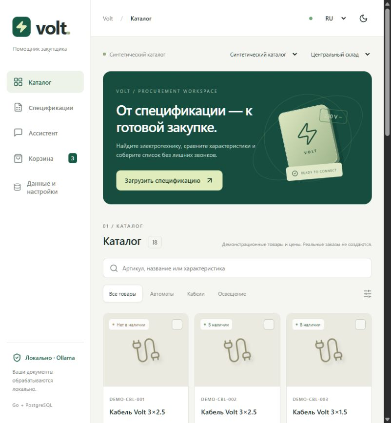

# Volt Assistant

[](https://github.com/IliasGalikhanov/volt-assistant/actions/workflows/ci.yml)

Локальный помощник по закупке электротехнических товаров. Загрузите спецификацию, проверьте найденные позиции и возможные замены, подтвердите состав корзины и экспортируйте список закупки.

Go · React / TypeScript · PostgreSQL · Ollama / Qwen3.5



Самостоятельный портфолио-проект по мотивам завершённого хакатона. Это **не официальный сервис ekt.kz**. Все данные демонстрационного каталога вымышлены; реальные заказы, резервирование и платежи не выполняются.

## Запуск из чистого клона

Нужны Git, Docker с Compose v2 и Python 3.10+ для однократного создания локальной конфигурации. Go, Node и модель для запуска демо устанавливать не требуется. В Windows используйте Docker Desktop с Linux containers; на Linux команда Python обычно называется `python3`.

```sh
git clone https://github.com/IliasGalikhanov/volt-assistant.git
cd volt-assistant
python scripts/init_env.py
docker compose up --build --wait -d app worker
```

Откройте **http://127.0.0.1:8080**. Скрипт создаёт игнорируемый Git файл `.env` со случайным паролем PostgreSQL. Существующий `.env` он не перезаписывает. Порты 8080, 55432 должны быть свободны; порт интерфейса можно изменить через `APP_PORT` в `.env`.

```sh
docker compose ps
docker compose logs --tail=50 app worker
docker compose stop app worker db
docker compose up --wait -d app worker
```

Каталоги, задания, диалоги и корзины находятся в томе `postgres`, загруженные файлы — в `uploads`. Обычный `stop`, `restart` или `down` без `-v` сохраняет эти тома. Не удаляйте тома и `.env`, если хотите сохранить установку. Изменение пароля только в `.env` не меняет пароль уже созданной БД.

## Попробовать за две минуты

1. Оставьте источник «Синтетический каталог» и «Центральный склад».
2. Откройте «Спецификации», скачайте [пример CSV](frontend/public/examples/specification.csv) и загрузите его.
3. Нажмите «Проверить позиции». `DEMO-MCB-001` отсутствует; откройте возможные замены и выберите `DEMO-MCB-002`.
4. Проверьте количество, поставьте отметку проверки и подготовьте корзину. До отдельного подтверждения корзина не меняется.
5. Подтвердите предложение: три позиции, итог **15 890 ₸**. Скачайте CSV или XLSX. Перезагрузка страницы сохраняет корзину.

В «Данные и настройки» можно импортировать [синтетический пользовательский каталог](frontend/public/examples/catalogue.json), выбрать модель или поиск без модели. В шапке — русский, казахский, английский и переключатель темы.

После запуска модели можно проверить распознавание [синтетической спецификации PNG](docs/fixtures/specification.png). На проверенном CPU её обработка заняла около 49 секунд; итоговые строки всё равно нужно подтвердить вручную.

## Локальная модель

Основной вариант — `qwen3.5:4b-q4_K_M`; резервный — `qwen3.5:2b`. Обучения на каталоге нет: модель извлекает поисковый запрос и строки с фотографии, а товары, цены, остатки и изменения корзины определяет сервер.

```sh
docker compose --profile ai up -d ollama
docker compose exec ollama ollama pull qwen3.5:4b-q4_K_M
python scripts/warm_model.py
# Необязательно, для ручного переключения на меньшую модель:
docker compose exec ollama ollama pull qwen3.5:2b
```

На компьютере с поддерживаемой NVIDIA GPU вместо первой команды:

```sh
docker compose -f compose.yaml -f compose.gpu.yaml --profile ai up -d ollama
```

Для уже установленной Ollama контейнер не нужен: приложение обращается к `host.docker.internal:11434`. При использовании Compose-сервиса можно задать `COMPOSE_OLLAMA_URL=http://ollama:11434` в `.env` и пересоздать `app worker`. Не запускайте одновременно два сервера Ollama на одном порту.

Первый запуск включает загрузку нескольких гигабайт и прогрев. Холодная загрузка может превысить 55-секундный тайм-аут чата; в этом случае поиск продолжает работать без модели. Проверьте `docker compose exec ollama ollama ps` и повторите запрос после прогрева. 2B выбирается вручную в настройках; приложение не скачивает её автоматически. Наличие GPU не гарантирует, что вся модель поместится в видеопамять.

Если гибридный CPU/GPU режим на малой VRAM работает медленно, задайте `OLLAMA_NUM_GPU=0` в `.env`, выполните `docker compose up -d app worker`, затем `python scripts/warm_model.py`. Пустое значение оставляет автоматический выбор Ollama. Эта настройка действует и на прогрев, и на вызовы из приложения.

## Что реализовано

- Поиск и фильтры каталога, карточки, склады и сравнение до четырёх товаров.
- Правила возможных замен для автоматов, кабелей и LED-ламп с перечислением совпадений и различий. Неполные характеристики не считаются совпадением.
- Каталоги CSV/XLSX/JSON: проверка, сопоставление колонок, предпросмотр, атомарный импорт в отдельный набор данных.
- Спецификации CSV/XLSX/JSON/DOCX/текстовый PDF; JPEG/PNG через доступную локальную мультимодальную модель. Все позиции проходят ручную проверку.
- Фоновая обработка файлов, сохраняемые результаты и ошибки, удаление вложений и истории диалога.
- Предложения корзины с ограниченным сроком действия, проверка цены/остатка/кратности, защита от повторного подтверждения и конфликтов.
- Постоянная корзина, CSV/XLSX, три языка, две темы, мобильная навигация.
- Необязательный адаптер ekt.kz только для чтения. Учётные данные задаются локально; публичное демо их не требует.

## Разработка и проверки

Требуются Go 1.25+, Node 24, PostgreSQL 17. Poppler (`pdftotext`) нужен для PDF при запуске worker вне Docker. В контейнер он уже включён. Загрузите переменные `.env` в окружение своего терминала; приложение намеренно не читает файлы секретов автоматически.

```sh
docker compose up -d db
cd frontend
npm ci
npm run build
cd ../backend
go run ./cmd/server
# В другом терминале с теми же переменными и рабочей папкой backend:
go run ./cmd/worker
```

Для разработки UI: `npm run dev` из `frontend` (Vite проксирует `/api` на сервер 8080).

```sh
cd backend
go vet ./...
go test ./...
# TEST_DATABASE_URL должен указывать на отдельную тестовую PostgreSQL.
# Без него интеграционные тесты явно пропускаются.
go test -race -count=1 -timeout=120s ./...
cd ../frontend
npm ci
npx playwright install chromium
npm run build
npm run test:e2e
cd ..
python scripts/persistence_check.py
```

Последняя команда создаёт синтетическую корзину и **перезапускает сервисы текущего Compose-проекта**. Запускайте её отдельно от браузерных тестов. CI выполняет race/integration-тесты Go, сборку UI, npm audit, Docker build, Playwright и проверку сохранности данных на чистом GitHub runner.

## Документация и ограничения

- [Архитектура](docs/architecture.md), [форматы входных данных](docs/data-formats.md), [права и требования исходного задания](docs/data-rights.md).
- [OpenAPI-контракт](docs/openapi.json) описывает HTTP API и обязательные подтверждения.
- [Проверки и ограничения качества](docs/verification.md), [зависимости и лицензии](THIRD_PARTY_NOTICES.md), [безопасность](SECURITY.md).

Сеанс принадлежит cookie этого браузера; очистка cookie лишает доступа к его данным через UI. Аккаунтов и восстановления доступа нет. Это локальное однопользовательское приложение, не готовый публичный многопользовательский сервис.

Сканы внутри PDF и старые XLS/DOC не поддерживаются; преобразуйте их в текстовый PDF, JPEG/PNG или таблицу. Денежные суммы — целые тиыны, количества — целые штуки/метры с кратностью; дробные метры пока не поддерживаются. Корзина ограничена 100 строками, спецификация — 500, каталог — 10 000, файл — 10 MiB. Отредактированные строки проверки пока не сохраняются до подготовки корзины.

Реальные данные, сертификаты, условия доставки и электрическая совместимость требуют подтверждения поставщика/специалиста. Для ekt.kz семантика валюты, единиц и кратности не установлена: такой каталог доступен для просмотра, добавление в корзину заблокировано. Метрики синтетических проверок не доказывают качество на реальных данных.
