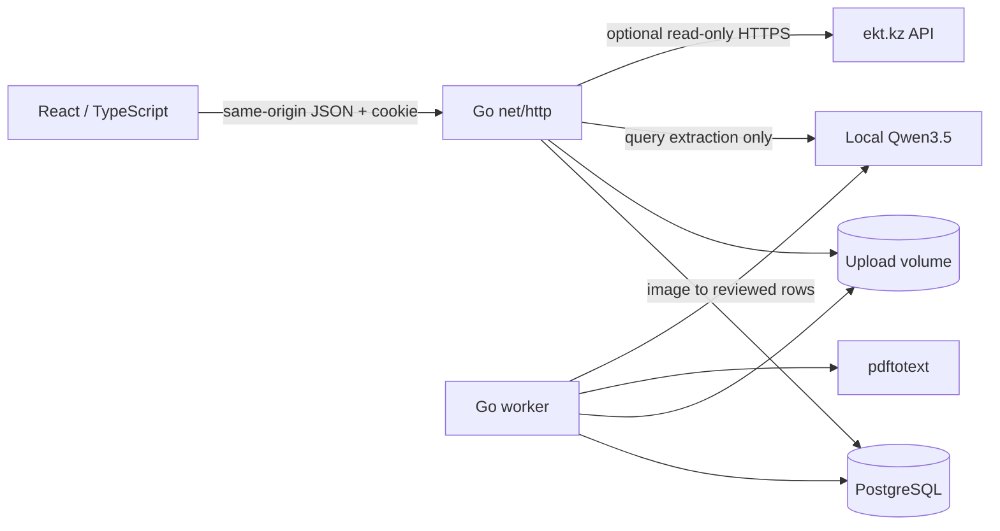

# Architecture

Volt is a Go modular monolith with two executables: HTTP server and background worker. React/TypeScript is served by the same server. PostgreSQL holds durable state; Ollama is optional. This keeps deployment small while allowing document parsing to run outside HTTP requests. There is no Redis, vector database, Python inference service or model training pipeline.

## Boundaries

| Module | Responsibility |
| --- | --- |
| `catalog` | Product validation, immutable dataset imports, deterministic search and synthetic seed |
| `alternatives` | Category-specific compatibility candidates with explicit matched/different attributes |
| `cart` | Quantity/stock/price checks, proposals, transactional and idempotent confirmations |
| `documents` | Bounded CSV/JSON/XLSX/DOCX/text-PDF parsing |
| `jobs` | Persistent queue, processing leases, reviewed extraction results and errors |
| `ollama` | Structured local model requests, timeout and response parsing |
| `ekt` | Fixed-host, read-only supplier adapter with unverified fields withheld |
| `httpapi` | Session ownership, CSRF, input limits, HTTP contract, exports and static files |
| `storage` | pgx pool, ordered, atomic forward migrations under a transaction advisory lock |

Frontend pages live in `src/pages`; dialogs are independent components. `useWorkspaceData` manages initial reads, cancellation and polling; `useCatalogueFilter` delegates query semantics to the API; `useReviewDraft` loads and saves revisioned edits. App coordinates navigation and selected dialogs. Theme, language and selected dataset preferences use localStorage; business data stays in PostgreSQL. Catalogue pages render at most 24 cards while the complete bounded dataset remains available for selection.

Review drafts are separate from extracted rows. PUT includes the last observed draft revision; a stale tab receives HTTP 409 and keeps its local edits visible. Save draft is explicit, and preparing a proposal saves first. Unsaved edits trigger a close/reload warning. Changing warehouse invalidates acknowledgement.

## Data and transactions

PostgreSQL tables: `sessions`, `datasets`, `products`, `carts`, `proposals`, `messages`, `jobs`, `schema_migrations`. Flexible product attributes and snapshots use JSONB; ownership, IDs, revisions and queue state use relational columns and foreign keys. Dataset ID is part of product/cart lookup. User datasets belong to one random 192-bit cookie session. Only the synthetic dataset is shared.

Cart proposal creation validates SKU, warehouse, positive quantity, pack multiple, stock, currency and price. The proposal stores the complete resulting cart and its revision, expires after ten minutes, and cannot itself mutate the cart. Confirmation locks the cart and proposal, checks ownership/revision/expiry, locks current product records, rechecks the quoted values and commits cart plus proposal status together. Repeating the same confirmation returns the current cart without adding quantities again. No warehouse stock is reserved.

Catalog imports create a new dataset; they never mutate the active version in place. Import confirmation locks its job and creates the dataset in the same transaction. Repeating it returns the already-created dataset. A failed import leaves existing data unchanged.

Worker claims a queued or expired job with `FOR UPDATE SKIP LOCKED`, assigns a two-minute lease and increments attempts. Repeatedly interrupted jobs fail after three attempts. Successful processing produces `review`; catalogue confirmation produces `completed`. Errors remain visible in `failed`. Original filenames are metadata only; stored paths are generated. Worker completion is conditional on the claimed attempt number, so a late expired worker cannot overwrite a replacement result. Cancellation leaves the lease recoverable. SQL migrations 001 and 002 support both fresh installation and upgrade from the original version-one database; newer unsupported versions are rejected. Failed upgrades roll back atomically.

## Model role and limits

Qwen receives the current user request and the previous assistant's displayed product names/SKUs. It returns a constrained `{query,intent}` plan; only `search` and `conditions` intents are accepted. Catalog search supplies actual product records, and localized server templates render the reply. The model cannot set prices, reserve stock, execute arbitrary tools or confirm cart changes. An exact user-supplied article takes precedence over a rewritten model query.

Image extraction returns `{rows:[{query,quantity}]}` for human correction. Model/schema errors and unavailable Ollama do not disable catalog browsing or manual specification workflows. Model calls use a bounded context and a 55-second timeout. This is a constrained procurement assistant, not an unrestricted conversational agent or engineering authority. No embeddings are necessary for the current bounded catalog scope.

Search and attribute rules run in memory after loading a dataset, bounded at 10 000 records. A much larger live catalog would require indexed server search, incremental synchronization, a documented supplier mapping and rate-limit policy. No claims about production-scale throughput are made.

## Deployment

One multi-stage image contains two Go binaries, the built UI and Poppler. Runtime uses an unprivileged user. Compose runs app, worker and PostgreSQL with durable named volumes and loopback ports; Ollama is a separate opt-in profile. NVIDIA support is an explicit override. Healthchecks test database connectivity through the app. Backend integration tests use a separate ephemeral PostgreSQL in CI; application tests build and run Compose from the checkout.

## Diagnostics

API responses carry X-Request-ID. Logs include request ID, route pattern, status and duration; worker events include job ID, attempt, duration, error code and whether the result was applied. Bodies, queries, cookies and uploaded filenames are excluded. Health polling is quiet. UI error messages are localized by stable error code.

## Decision records

- [Go and PostgreSQL queue](decisions/001-go-and-postgres.md)
- [Model authority and failure modes](decisions/002-model-boundary.md)
- [Drafts and migrations](decisions/003-review-and-migrations.md)
- [Local runtime and catalogue scale](decisions/004-local-runtime-and-scale.md)
